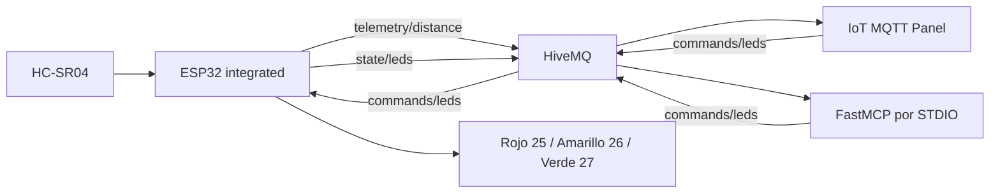

# Arquitectura

La arquitectura definitiva usa una placa y una sesión MQTT, con MQTT_CLIENT_ID
del rol FIRMWARE ya existente. Los entornos separados siguen disponibles con
sus identidades anteriores. UUID, prefijo y contratos no cambian.

## Separación de responsabilidades

- `iot_shared.config` y `local_config`: leer `.env`, derivar tópicos e identidades
  y exportar solo cabecera compartida y referencia móvil. No abren conexiones.
- `iot_shared.messages`: contrato estricto de distancia, LedCommand y LedState.
  Los modelos SG90 previos siguen disponibles para referencia histórica.
- `iot_shared.leds`: transformaciones only_led/all_off y modelo con estado LedDevice.
- Firmware: `LedSettings` configura y bloquea GPIO; `LedCommandParser` valida;
  `LedController` mantiene estado y deduplicación; la aplicación aplica GPIO y
  confirma. `WifiMqttConnection` gestiona explícitamente Wi-Fi/MQTT y reconexión.
- En integrated, `AsyncHcsr04` captura ECHO por interrupciones; loop programa las
  mediciones y entrega la última a una cola acotada. Una tarea FreeRTOS es la
  única propietaria del cliente MQTT, callbacks, control LED y confirmaciones.
  Las esperas síncronas de red no detienen el bucle de medición.
- Simulador: SimulatedDevice compone el modelo compartido en memoria. Su transporte
  MQTT y ciclo de vida start/close siguen pendientes; importar no crea conexiones.
- MCP: `DeviceTools` expone las seis herramientas y reutiliza las funciones
  prepare_* y validadores comunes. `DeviceState` mantiene observaciones con edad.
  `MqttGateway` protege el estado entre hilos, gestiona Paho, suscripciones,
  espera de confirmaciones y un historial acotado de comandos. `build_server`
  compone FastMCP sin abrir red; su lifespan inicia/cierra MQTT. El protocolo usa
  stdout y el diagnóstico stderr. [Registro manual y pruebas](../mcp-server/README.md).
- Móvil: el usuario comprobó IoT MQTT Panel con distancias y LEDs. La referencia
  JSON de gauge y tres interruptores se conserva sin alterar su configuración.

Los componentes con estado son clases; las transformaciones son funciones.
No hay automatismos que enciendan luces a partir de distancias ni un semáforo.
La orden exclusiva es un único mensaje con los tres booleanos explícitos.

## Alcance de applied

El actuador confirma niveles GPIO asignados, no iluminación medida. El simulador
confirma memoria. MCP solo confirma tras correlacionar un state/leds con command_id
y verificar los colores solicitados, sin confundirlo con el éxito de publish.
Muestra estado desconocido, obsoleto o tiempo agotado según corresponda.
Las pruebas de integración son locales con dobles; broker y hardware quedan
fuera de su ejecución predeterminada.
