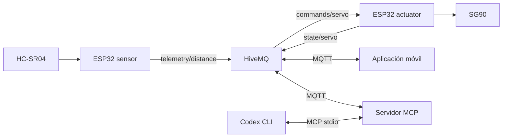

# Referencia histórica del actuador SG90

Documento archivado; el actuador activo utiliza LEDs. Los comandos de carga y rutas de esta copia describen la etapa anterior y no deben usarse para el firmware activo.

# Dos ESP32 como objeto inteligente distribuido

La práctica se divide en un nodo sensor y otro actuador. Ambos usan el mismo
broker, prefijo y contratos JSON existentes. El UUID local no se regenera y
`.env` no se modifica durante esta adaptación.

**Pendiente académico:** confirmar con el docente que acepta dos ESP32 como
un objeto inteligente distribuido. La propuesta es presentar ambos nodos como
partes de una función conjunta: observar distancia y actuar mediante el mismo
sistema MQTT/móvil/MCP. No se ha solicitado ni recibido esa aceptación.

## Arquitectura



Las placas se comunican por Wi-Fi y el broker; no necesitan un cable de datos
entre ellas. Cada periférico mantiene GND común con su propia placa. El móvil
y el servidor MCP siguen pendientes de implementación funcional.

| Entorno | Responsabilidad | Pines |
| --- | --- | --- |
| `sensor` | Medir HC-SR04 y publicar distancias válidas | TRIG 5, ECHO 18 con divisor |
| `actuator` | Validar órdenes, aplicar consigna SG90 y confirmar | Señal 25, por verificar |
| `hardware-diagnostic` | Diagnóstico anterior sin MQTT | Servo 19, TRIG 5, ECHO 18 |
| `esp32dev` | Esqueleto anterior, conservado por compatibilidad | Sin periféricos |

Se mantiene la placa DOIT DevKit V1 para ambos entornos principales. Si la
segunda placa es otro modelo ESP32, ajustar su opción `board` antes de cargarla.
Cada entorno tiene un filtro de fuentes exclusivo, con su propio `setup/loop`.
Los entornos predeterminados de compilación son `sensor` y `actuator`.

## Identidades y contratos conservados

Las tres rutas siguen siendo las derivadas por `iot_shared.topics`:

| Tópico relativo al prefijo existente | Productor | Consumidor |
| --- | --- | --- |
| `telemetry/distance` | ESP32 sensor | Móvil y MCP |
| `commands/servo` | Móvil y MCP | ESP32 actuator |
| `state/servo` | ESP32 actuator | Móvil y MCP |

No cambian campos, tipos, rangos, QoS 0 o `retain=false`. El sensor usa
`device_id="sensor-01"` y el actuador `device_id="actuator-01"`, ambos válidos
en el contrato anterior. Los detalles y ejemplos permanecen en [MQTT](../mqtt.md).

Los roles añadidos `ClientRole.SENSOR` y `ClientRole.ACTUATOR` derivan client_id
con sufijos `-sensor` y `-actuator` a partir del mismo UUID. Los cuatro roles
anteriores conservan sus identificadores; `FIRMWARE`/`-esp32` es solo compatibilidad,
no una tercera placa activa. La cabecera exporta ambos identificadores nuevos.

## Configuración local, sin credenciales en Git

Desde la raíz, sincronizar usando el UUID existente, sin ejecutar una nueva
generación manual de UUID ni reemplazar `.env`:

```powershell
python -B -m iot_shared sync
python -B -m iot_shared check
python -B -m iot_shared show
```

`mqtt_config.local.h` se regenera desde `.env` y aporta broker, tópicos, tiempos,
límites y client_id. No contiene Wi-Fi. Las credenciales y pines están en una
copia local de la nueva plantilla; copiarla una sola vez, sin sobrescribir una
configuración existente:

```powershell
Copy-Item -LiteralPath firmware/include/device_config.example.h -Destination firmware/include/device_config.local.h
```

Editar exclusivamente esa copia para establecer el SSID y contraseña locales.
Si falta la copia, ambos entornos compilan con la plantilla; el SSID vacío evita
intentar Wi-Fi al ejecutarlos. Ninguna clave o SSID se imprime en los logs.

**GPIO 25 está sujeto a verificación del cableado del SG90.** Tras comprobar
señal, alimentación y masa de esa placa, establecer en la copia local:

```cpp
constexpr int ACTUATOR_SERVO_PIN = 25;
constexpr bool ACTUATOR_WIRING_CONFIRMED = true;
```

Por defecto la bandera es `false`: el actuador puede preparar su conexión si
hay credenciales, pero no configura el pin del servo ni acepta movimientos ni
publica una confirmación `applied` falsa. El diagnóstico mantiene GPIO 19 y su
configuración independiente. `device_config.local.h` está ignorado por Git;
`sync` no lo modifica. `config.h` anterior tampoco se altera ni se usa en estos
dos entornos nuevos.

## Comportamiento preparado

El sensor mide cada `DISTANCE_PUBLISH_INTERVAL_MS` (1000 ms por defecto, mínimo
60 ms para este firmware). Espera el eco hasta 30 ms y descarta lecturas sin eco
o fuera de 2–400 cm. Publica el JSON existente; durante una desconexión descarta
lecturas y vuelve a medir, sin reproducir una cola de valores antiguos.

El actuador solo procesa `commands/servo` del prefijo propio. El analizador C++
del esquema rechaza duplicados, campos desconocidos, UTF-8/IDs inválidos,
booleanos, cadenas, decimales, exponentes y datos adicionales. Conserva el orden
libre de campos, los escapes Unicode que representan IDs ASCII y el límite de
1024 bytes. Se compara contra `ServoCommand.from_json` en las pruebas.

Una orden válida inicia una rampa de un grado cada 25 ms. Después del último
paso espera 500 ms y prepara `ServoState` con el mismo `command_id`, ángulo,
dispositivo, uptime y `status="applied"`. El SG90 conserva la última señal PWM
de 50 Hz después de confirmar y entre órdenes. Se mantienen los pulsos de
1000–2000 µs y los límites de ángulo exportados desde `.env`.

`attach()` y `setPeriodHertz(50)` se ejecutan solo si el servo no está conectado.
El periférico LEDC repite los pulsos sin necesitar llamadas continuas a `write()`.
La finalización normal ya no ejecuta `disableServo()`, `detach()` ni GPIO LOW.
La desactivación se conserva al arrancar con cableado confirmado y cuando falla
la asociación PWM detectada por el firmware. El arranque espera una orden válida:
no genera barridos ni movimientos periódicos. La plantilla sigue bloqueada por
`ACTUATOR_WIRING_CONFIRMED=false`.

El centrado inicial asume 90° limitados al intervalo configurado; puede mover el
servo al recibir la primera orden porque no hay sensor de posición. La
confirmación describe una consigna aplicada, no posición medida ni corriente o
temperatura verificadas. Una orden al ángulo actual también espera 500 ms antes
de confirmar y conserva PWM.

Hay una sola orden activa y una confirmación pendiente. Si llegan otras órdenes
mientras está ocupado, se descartan y se registran por serie; no se inventa un
estado de error incompatible con el contrato. Se reconocen duplicados de la
orden activa y de la última aplicada. Repetir la última con igual ángulo vuelve
a confirmar sin mover; reutilizar su ID con otro ángulo se rechaza. No es un
historial ilimitado ni persistente tras un reinicio.

Si se pierde MQTT durante un movimiento, termina la orden validada y conserva
PWM y su confirmación en memoria para reintentar después. No acepta otra hasta
enviar la pendiente. QoS 0 no garantiza entrega: un envío TCP exitoso no equivale
a confirmación de recepción del cliente. La memoria pendiente se pierde al reiniciar.

## Alimentación del SG90 y observación manual

El montaje actual tiene un SG90 sin carga alimentado desde el pin 5V del ESP32
mediante USB. Eso no garantiza suficiente corriente: intervienen la fuente USB,
el cable, las conexiones y las protecciones de la placa. Mantener PWM permite
que el servo siga corrigiendo su posición y consumiendo corriente aunque no
reciba nuevas órdenes. El cambio no añade sensores eléctricos ni un corte
automático por calentamiento, consumo o pérdida de MQTT.

Para una comprobación física posterior, mantener el brazo sin carga y libre de
obstáculos. Enviar manualmente una sola orden cada vez y esperar su `applied`
con el mismo `command_id` antes de enviar otra. No realizar barridos automáticos
ni ampliar 1000–2000 µs para intentar corregir un problema de alimentación.

| Síntoma | Cómo observarlo y cómo proceder |
| --- | --- |
| Reinicios repetidos | En un monitor serie abierto manualmente, buscar de nuevo `ESP32 actuator:`, mensajes de arranque `rst:` o un aviso como `Brownout detector was triggered`. El `uptime_ms` de una confirmación posterior también puede volver a un valor pequeño. Un aviso de brownout puede no llegar a imprimirse. Suspender el ensayo y revisar alimentación y conexiones. |
| Vibración persistente o movimientos sin orden nueva | Observar el brazo y escuchar zumbidos intensos mientras debería mantener una posición. Revisar alimentación, GND común, señal GPIO 25 y fijación mecánica; no forzar el eje ni compensarlo con pulsos más amplios. |
| Calentamiento creciente o rápido | Vigilar servo, placa, cable y conector USB durante un ensayo breve; usar un termómetro si está disponible. Si aparece calentamiento anormal, olor o ruido fuerte, retirar la alimentación del servo y revisar el montaje antes de repetir. |
| Consumo excesivo o tensión que cae | Usar manualmente un medidor USB o una fuente con indicación y limitación de corriente; comparar reposo y retención, y comprobar tensión junto al servo si se dispone de instrumentos. El consumo USB incluye también el ESP32. Dimensionar la alimentación según las especificaciones de los componentes, sin asumir una corriente disponible por el solo hecho de usar el pin 5V. |

Si hace falta una fuente regulada independiente adecuada al SG90, compartir GND
con el ESP32 y alimentar el positivo del servo desde esa fuente. Evitar unir su
positivo con el pin 5V alimentado por USB, para no realimentar las fuentes.
Hacer los cambios de cableado con las alimentaciones desconectadas.

Para terminar un ensayo físico se retira manualmente la alimentación del servo.
Desconectar MQTT no libera PWM. El comando serie `x` pertenece únicamente al
diagnóstico antiguo de GPIO 19; no es una orden del actuador MQTT en GPIO 25.

## Reconexión automática

`WifiMqttConnection` es común a ambos nodos. Wi-Fi usa intentos con plazo de
10 segundos y esperas progresivas configuradas inicialmente de 1 a 32 segundos.
MQTT empieza después de Wi-Fi, mantiene `loop()` y vuelve a solicitar la
suscripción del actuador después de cada conexión con sesión limpia.

No hay un bucle infinito de conexión ni `delay()` largo para reintentar.
PubSubClient conecta de forma síncrona: se configuran límites de conexión TCP
de 1500 ms y espera MQTT de 2 segundos; la resolución DNS depende de la pila
Wi-Fi. Un intento puede pausar momentáneamente el bucle. La rampa no recupera
pasos atrasados de golpe. Los parámetros Wi-Fi/TCP están en la plantilla local;
las esperas mínima/máxima se exportan desde `.env`.

Se fija [PubSubClient 2.8](https://pubsubclient.knolleary.net/api) y
[ESP32Servo 3.2.1](https://github.com/madhephaestus/ESP32Servo), con plataforma
Espressif32 8.0.0 y Arduino ESP32 3.3.12. Los publicadores usan QoS 0 y mensajes
no retenidos. El emisor de órdenes también debe respetar `retain=false`;
PubSubClient no expone ese indicador al callback de recepción.

## Compilar y probar sin conectar placas

Desde la raíz en PowerShell:

```powershell
$pioDistribuido = "$env:USERPROFILE\.platformio\penv\Scripts\pio.exe"
& $pioDistribuido run -d firmware -e sensor -e actuator
& $pioDistribuido run -d firmware -e hardware-diagnostic -e esp32dev
python -B -m unittest discover -s tests -v
python -B -m iot_shared check
```

No incluyen carga o apertura de puertos. Las pruebas con G++ se ejecutan en el
PC: backoff, rampa, confirmación pendiente, duplicados y equivalencia C++/Python.
También se conserva la prueba de secuencia del diagnóstico. Las diez pruebas de
`tests/test_actuator_application.py` incluyen el archivo real del actuador y
sustituyen Arduino, Servo, configuración y transporte por dobles sin hardware.
Comprueban retención después de `applied`, una sola asociación PWM entre órdenes,
arranque, fallo de asociación, validación, duplicados, desconexión, reintentos y
desbordamiento de reloj. No leen Wi-Fi ni `.env` reales. Si no hay G++, las
catorce pruebas C++ se omiten expresamente. Estas pruebas no miden la señal
eléctrica ni el ángulo físico; esa comprobación requiere hardware e instrumentos.

Los binarios quedan en `firmware/.pio/build/<entorno>/firmware.bin`.
La compilación exclusiva de este cambio se hace con
`& $pioDistribuido run -d firmware -e actuator`.

## Carga y monitor del actuador: solo ejecución manual

Los comandos siguientes son instrucciones para el usuario; no forman parte de
las pruebas ni se ejecutan automáticamente. Mantener desconectada la alimentación
del SG90 durante la programación y seleccionar el puerto de la placa actuadora,
verificado en el Administrador de dispositivos. Sustituir `COM_ACTUADOR` antes
de ejecutar, sin reutilizar por error el puerto de la placa sensor.

Desde la raíz del proyecto en PowerShell:

```powershell
$pioActuador = "$env:USERPROFILE\.platformio\penv\Scripts\pio.exe"
$puertoActuador = "COM_ACTUADOR" # Sustituir por el puerto de la placa actuadora.
& $pioActuador run -d firmware -e actuator -t upload --upload-port $puertoActuador
```

El comando compila y carga únicamente `actuator`; no selecciona `sensor`.
La carga no modifica los archivos locales de Wi-Fi, UUID o tópicos del proyecto.
Revisar el montaje antes de volver a alimentar el SG90, con las fuentes apagadas
durante cualquier cambio de cableado.

Para observar los mensajes, el usuario puede abrir después el monitor:

```powershell
& $pioActuador device monitor --port $puertoActuador --baud 115200
```

Abrir el monitor puede provocar un reinicio por DTR/RTS; distinguir ese arranque
inicial de reinicios repetidos durante el ensayo. Cerrar con `Ctrl+C`. El monitor
solo muestra logs: el actuador espera órdenes MQTT válidas, no comandos serie
`s`/`x`. Tras una carga o reinicio puede volver a conectar al broker usando su
configuración local, por lo que el emisor debe respetar `retain=false` y no
enviar órdenes automáticamente durante la revisión del montaje.

## Resultado de la verificación

Verificación de la corrección de retención PWM, 24 de octubre de 2026:

- PlatformIO: `actuator`: SUCCESS. RAM: 47 740 bytes (14.6%); flash:
  983 423 bytes (75.0%). Solo se compiló este entorno en esta corrección.
- Pruebas Python/C++: 51 ejecutadas y aprobadas, sin omisiones en este equipo;
  incluyen los diez escenarios nuevos de la aplicación real con dobles.
- Antes de corregir la aplicación, la prueba de retención falló al comprobar
  que PWM estuviera activo al publicar `applied`; con el cambio pasa.
- `python -B -m iot_shared check`: configuración local válida, sin ejecutar
  `sync` ni modificar `.env`.
- `.env`, Wi-Fi, pines y bandera locales, plantilla de dispositivo, cabecera
  generada, configuración PlatformIO, fuentes del sensor y diagnóstico, y
  validadores/tópicos MQTT: idénticos a los anteriores según SHA-256.

No se cargó firmware, abrió un puerto serie ni ejecutó un cliente contra el
broker durante esta corrección. La aceptación académica y las pruebas físicas
y de red permanecen pendientes.
